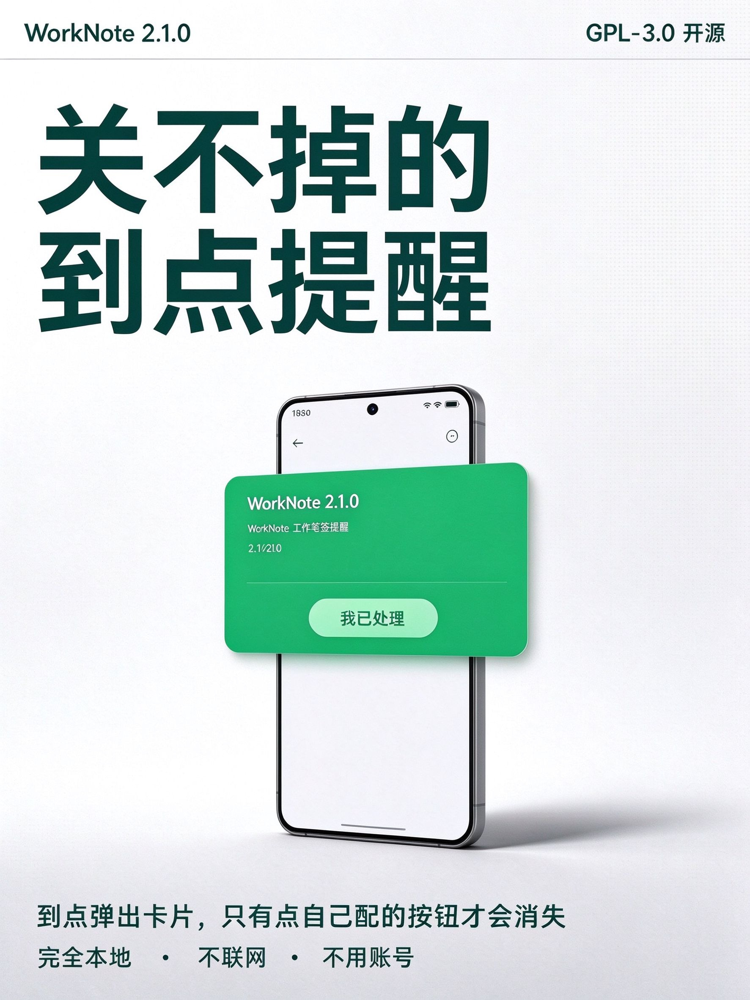
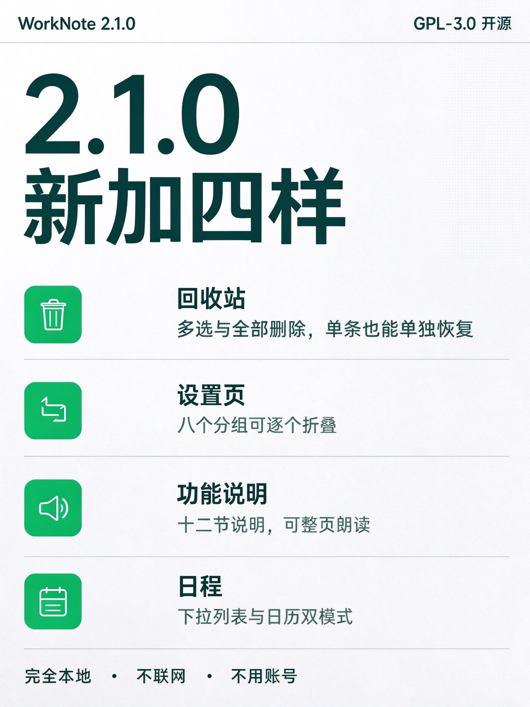
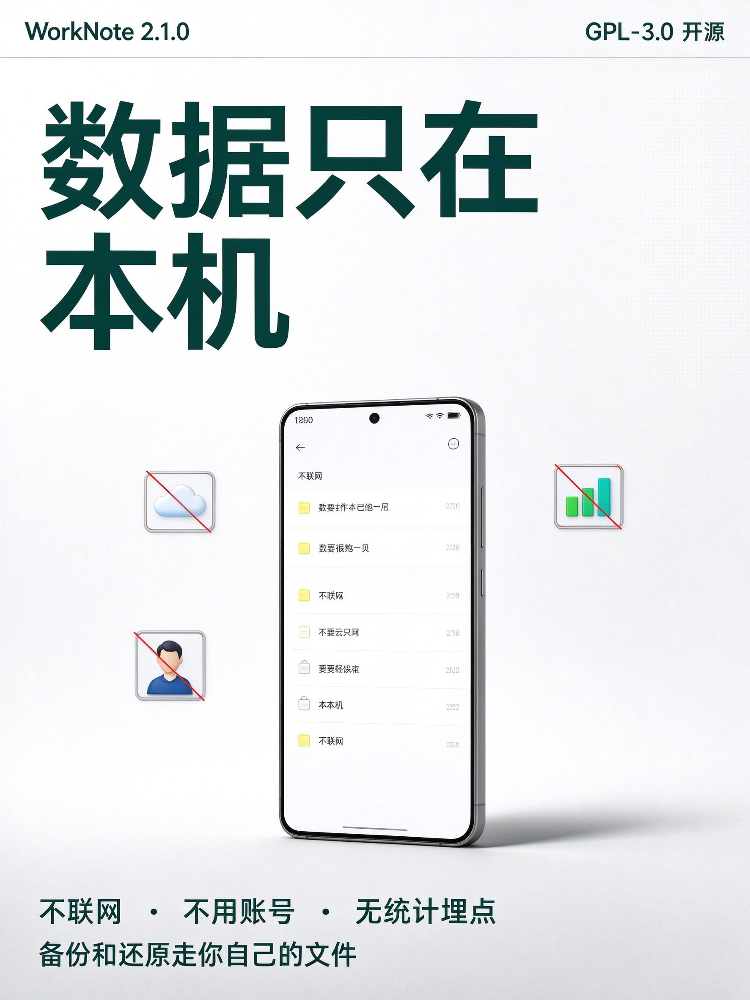
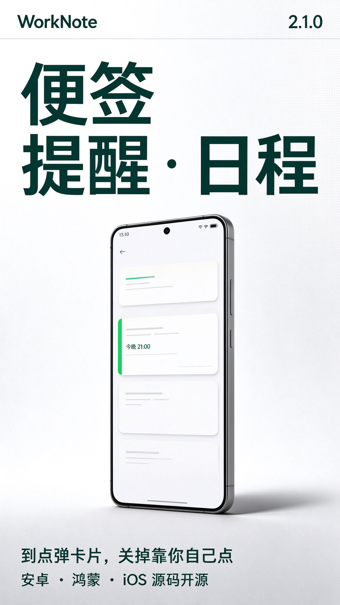
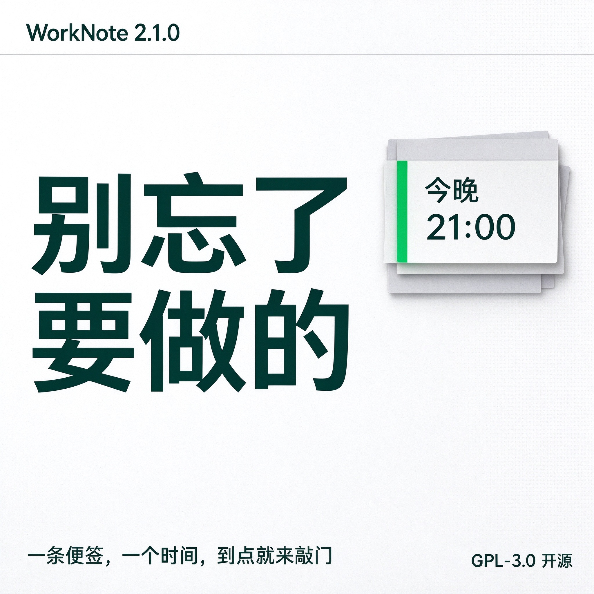
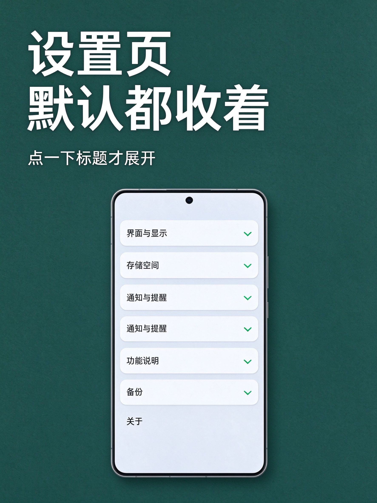
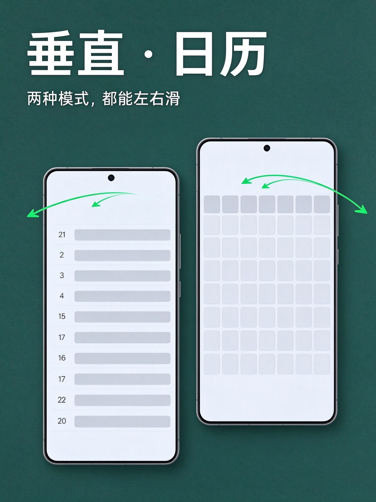
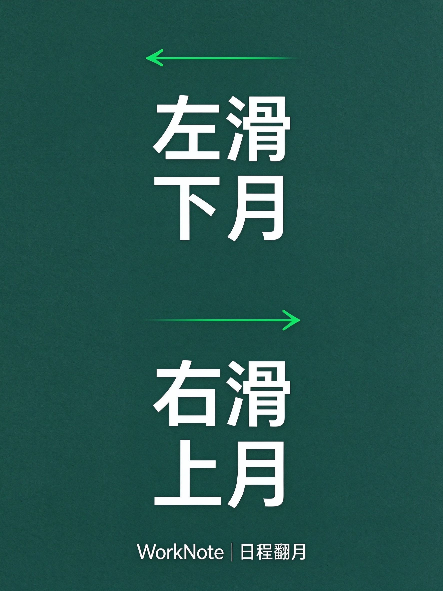

# 工作便签提醒（WorkNote）

一个**完全本地、不联网、不用账号**的强提醒便签 App：到点弹一张盖在屏幕最上层的卡片，卡片上没有关闭按钮，**必须点了自己配的按钮才会消失**。

单机自用为主，顺便开源出来给需要的人，**不上架任何应用商店**。

- 许可证：**GPL-3.0**（全文见 [LICENSE](LICENSE)）
- 版本：2.1.0（三端同一份数据模型，同一个包名 `com.workspace.worknote`）
- 语言：跟随系统 / 简体中文 / 繁體中文 / English（三端都是四档）
- 主题：跟随系统 / 浅色 / 深色；字号 1~10 档

## 一、开源声明

这个项目是**自用项目**：先满足我自己的需求，功能优先，不追求商店级的打磨。代码按 GPL-3.0 公开，你可以免费用、改、二次分发，但**改完再发布必须同样以 GPL-3.0 开源并保留出处**。没有担保，装在自己手机上有任何问题自行承担。

如果你用它改出了更好的版本，欢迎提 issue / PR；自用分支的节奏可能跟不上你的期望，fork 走自己的路也完全没问题。

## 二、三个平台现在到哪一步了（请按此预期使用）

| 平台 | 代码 | 能不能装 | 说明 |
| --- | --- | --- | --- |
| Android | 完成 | **能**，签名 release 包已在真机跑过 | 只有它在真机上完整验证过，强提醒卡片、悬浮窗、自定义铃声、三档语言都实测过 |
| iOS | 完成 | **暂时不能** | Swift 源码与 CI 工作流都在，但 iOS 出安装包必须有 macOS + Xcode + 签名；本开发机是 Windows，只能靠 GitHub Actions 的 macOS runner 编译（目前只编模拟器版，不出 `.ipa`） |
| HarmonyOS NEXT | 完成 | **暂时不能** | ArkTS 源码与工程骨架都在，出 `.hap` 必须有 DevEco Studio 与本机签名证书；本开发机没有这套工具链 |

说直白点：**现在只有 Android 有真正的安装包**，iOS 与 HarmonyOS 交的是可编译源码。谁有对应工具链，谁就能自己编出来。

## 三、下载与安装

### Android（可用）

从本仓库的 [Releases](../../releases) 下载 `WorkNote-2.1.0-android-release.apk`，传到手机点开安装（需允许"安装未知来源应用"）。

或用 adb：

```powershell
adb install -r WorkNote-2.1.0-android-release.apk
```

装好后务必进【我】页把四项权限点亮（悬浮窗、忽略电池优化、通知、精确闹钟），国产 ROM 还要单独打开"自启动"和"后台运行"，否则到点可能不弹卡片。

### iOS（源码，需自编）

```bash
cd ios-app
brew install xcodegen
xcodegen generate --spec project.yml
open WorkNote.xcodeproj      # 用 Xcode 选真机运行，签名用你自己的 Apple ID
```

`project.yml` 里默认关闭了自动签名（`CODE_SIGNING_ALLOWED` 关），真机跑之前要在 Xcode 的 Signing & Capabilities 里选自己的 Team。

> CI 现状：仓库里带了 `.github/workflows/ios.yml`（macOS runner 上编译 + 跑单测 + 装模拟器截图），但本账号当前的 macOS runner 配额用不了，两个 job 一创建就被 cancel（0 步执行）。所以 **iOS 代码至今没有一次真实编译记录**，想验收只能在你自己的 Mac 上跑。

### HarmonyOS NEXT（源码，需自编）

用 DevEco Studio 打开 `ohos-app/`，`compatibleSdkVersion` 是 `5.0.0(12)`。真机安装需要先在 DevEco 里配好签名（自动签名或手动 p12 + p7b），否则只能跑模拟器。

## 四、三端各做了什么（功能对照）

| 能力 | Android | iOS | HarmonyOS NEXT |
| --- | --- | --- | --- |
| 强提醒卡片（不可随手关闭） | 悬浮窗置顶卡片，无 ×、无"稍后再说"，点遮罩/返回键都关不掉 | 通知 + 前台高频催办（系统不给第三方全局悬浮窗） | 通知 + 实况窗（同上，系统限制） |
| 关联日期 | 年/月/日 滚轮，底部「今天 / 取消 / 确定」 | 年月日圆盘 + 「今天」按钮 | 年月日选择框 + 「今天」按钮 |
| 定时提醒 | 年月日 + 时分五段滚轮 | 年月日 + 时分圆盘 + 「改到今天」 | 先选日期再选时分 + 「改到今天」 |
| 循环（每天/每周/每月） | 有 | 有 | 有 |
| 未处理就再弹 | 有（分钟级冷却） | 有 | 有 |
| 自定义提醒铃声 | 从本地音乐选一首，复制进应用私有目录，通知渠道静音、代码层出声 | 从文件选，`AVAudioPlayer` 播 | 从文件选，`AVPlayer` 播 |
| 自定义操作按钮 | 每条便签自己配文字与动作（完成 / 延后 / 只关卡片） | 同 | 同 |
| 回收站 | 逐条恢复 / 彻底删除，另加「多选 + 删除所选 + 全选 + 全部删除」 | 同 | 有 |
| 设置页分组折叠 | 分组标题**默认全部收起**，点一下展开、再点收起；组内内容与行为不变，状态跨次启动记住 | 同 | 同 |
| 功能说明页 | 12 节讲清每一页怎么用（设置页除外），带「内容播报」开关 | 同（`AVSpeechSynthesizer`） | 同（CoreSpeechKit） |
| 日程显示模式 | 「垂直（逐日展开）」与「日历（整月网格）」两档可切，同一份数据；**两种模式都能左右滑动翻月**（左滑下个月、右滑上个月） | 同 | 同 |
| 备份 `*.taskbak` | 有，三端同一格式 | 有 | 有 |
| 深色 / 字号 / 四档语言 | 有 | 有 | 有 |
| 背景图（三个 Tab 都显示） | 有 | 有 | 有 |

三端共享的数据契约（字段、状态、备份 JSON 结构）见 `docs/三端共享契约（数据模型与备份格式）.md`，校验脚本在 `contract/`。

## 五、强提醒是怎么做到的（Android 为例）

1. 到点由 `AlarmManager` 广播唤醒，前台服务 `ReminderService` 用 `TYPE_APPLICATION_OVERLAY` 把卡片盖在最上层，背景压暗。
2. 卡片上**没有关闭按钮**，也没有"稍后再说"；点背景、按返回键都不消失。
3. 每条便签的按钮自己配：文字自定，动作三选一 —— 标记完成 / 延后 / 只关卡片。
4. 没给悬浮窗权限时，自动退回全屏 `ReminderActivity`，规则完全一样。
5. 前台服务会在通知栏留一条常驻通知，这是 Android 对前台服务的硬性要求，不是任务提醒，删不掉。

## 六、数据在哪、隐私

- 所有便签只存在本机 SQLite（`worknote.db`），**没有网络请求、没有账号、没有云同步、没有统计埋点**。
- 备份文件 `WorkNote_年月日_时分.taskbak` 写在系统"下载/工作便签提醒"目录，纯 JSON，你自己能打开看。
- 卸载 App 会连同数据库一起删掉（系统行为），所以换签名、换机前先在【我】页导出备份。

## 七、自己编译（Android）

环境：Android Studio（AGP 9.1.0 / Gradle 9.3.1 / JDK 21）、compileSdk 36、minSdk 26。

```powershell
.\gradlew.bat assembleDebug      # 调试包
.\gradlew.bat assembleRelease    # 正式签名包
```

正式包需要你自己准备签名：在工程根放 `keystore.properties`（`storeFile / storePassword / keyAlias / keyPassword`）并放好 `.jks`。**这两个都不在仓库里**，仓库里也刻意 `.gitignore` 掉了 —— 我的签名私钥不会上传，谁要发自己的正式包就用自己的钥匙。

> 注意：debug 包与 release 包签名不同，互相覆盖会报 `INSTALL_FAILED_UPDATE_INCOMPATIBLE`，切换前必须卸载（会清空数据库，先导出 `.taskbak`）。

## 八、验证情况（如实写）

**已经真机验证（realme RMX5080 / Android 16，1080×2376）**

- 启动页、主界面、日程页、编辑页、「我」页全部截图核对
- 中文 / 繁體中文 / English 三档切换，界面文案整体跟着变
- 年月日滚轮：编辑页显示 `2026年11月8日 周日（今天）`，转到 11 日后变 `2026年11月11日 周三`，提醒时间同步
- 强提醒卡片弹出：遮罩 + 「我已处理」，无 ×、无稍后再说
- 自定义铃声：文件复制进私有目录成功，通知渠道 `mSound=null`（渠道静音、代码层出声）
- 签名 release 包 `adb install` 成功，`run-as` 报 `package not debuggable`（确认是正式包）

**2.1.0 的真机验证（同一台 realme，2026-11-11，全部通过）**

- `versionName=2.1.0 / versionCode=3`（`dumpsys package com.workspace.worknote` 读出），release 包覆盖安装，冷启动无 `AndroidRuntime:E`
- 回收站：新建临时便签 → 删除进回收站 → 「多选」后每行出勾选框、底部出现「全选 / 已选 N 条 / 删除所选」，勾选后弹确认框并删干净；再建一条后点「全部删除」确认，回收站变「回收站是空的」；测完恢复成 5 条便签
- 设置页折叠：点「界面与显示」分组标题，整组内容收起，再点一次展开；七个分组标题都正常显示
- 功能说明页：从「我」页「功能说明」行进入，标题、导语、播报开关、12 节正文全部渲染；打开播报开关后提示变「播报已开启：点小节标题只读这一节」并出现「播报整页说明」按钮；本机没有系统 TTS 引擎（`tts_default_synth` 为 null），页面正确降级成「这台手机没有可用的语音播报引擎」
- 日程双模式：默认「垂直」（当时叫「下拉」，本轮已改名「垂直」），切到「日历」后出现周日~周六表头、1~30 日历格、「2026年11月11日 周三（今天）」与「这天还没有便签」；点 27 号后下方标签与便签列表同步切换
- 全程只用 `uiautomator dump` 文本、`logcat`、`dumpsys` 断言，未落任何截图

**本轮改动（左右滑动翻月 + 设置默认收起）的验证深度**

- Android：`assembleRelease` 编译通过（BUILD SUCCESSFUL，含新增的手势代码与折叠逻辑反转），**未在真机安装、未做真机断言**——按用户要求不动真机当前任务，全程不落任何截图。
- iOS：本机无 Xcode，只做源码级修改，未编译。
- HarmonyOS：本机无 DevEco / hvigorw，只做源码级修改，未编译；三套 `string.json` 已用 JSON 解析校验（各 132 键，键集合不变）。

**还没验证到的**

- 自定义铃声"开关全开状态下到点真的响一声"的声学证据（两次卡片弹出时响铃开关是关的）
- iOS 与 HarmonyOS 的**任何编译**：本机没有 Xcode / DevEco，两边的代码只做过静态检查（JSON 能解析、三档语言键集合相等、括号配平）
- iOS 的 25 条单元测试从未执行
- 2.1.0 的 iOS / HarmonyOS 改动同样没有编译记录（源码已按同一套交互改完）

## 九、目录结构

```
app/                 Android 工程（Kotlin + XML + 原生 SQLite）
ios-app/             iOS 工程（SwiftUI，XcodeGen 生成工程）
ohos-app/            HarmonyOS NEXT 工程（ArkTS Stage 模型）
contract/            三端共享数据契约与 .taskbak 校验脚本
docs/                各功能的设计与验机记录
.github/workflows/   iOS 的 macOS CI（编译 + 模拟器截图）
```

更细的模块说明见 `docs/`：
- `docs/关联日期与提醒时间（三端）.md`
- `docs/自定义提醒铃声（三端）.md`
- `docs/三端繁体语言方案.md`
- `docs/发布与签名说明.md`
- `docs/界面与间距规范.md`
- `docs/promo/`（2.1.0 宣传物料五张，见第十一节）

## 十、已知限制

1. **只有 Android 能做"不可关闭的置顶卡片"**。iOS 与 HarmonyOS 不开放第三方全局悬浮窗，同一需求在那边只能降级成"通知 + 高频催办"，用户仍可划掉通知。
2. 国产 ROM 的省电策略会延迟甚至杀掉后台闹钟，需要手动加白名单。
3. 前台服务常驻通知无法隐藏，系统强制。
4. 日程页两种模式都按当月实际天数算（28~31 天），二月没有 30、31 号；日历模式的网格按周日打头。
5. HarmonyOS 端英文界面里日期单位「年 / 月 / 日」仍是中文，与 Android 不完全一致，待后续统一。

## 十一、宣传物料

配图放在 `docs/promo/`，五张同属一套视觉：品牌绿 #07C160 只做强调（卡片、按钮、色条、图块），文字用深墨绿 #10403B，冷白纸面 + 12 列网格。图内中文由图像模型生成，正式对外发布前请按原图再逐字核一遍。

**主视觉（3:4，1773×2364）**：到点弹出卡片，关掉只能点你自己配的按钮——卡片上没有任何关闭按钮。



**2.1.0 新增四项（3:4，1773×2364）**：回收站多选与全部删除 / 设置页分组折叠 / 功能说明可整页朗读 / 日程下拉与日历双模式。



**数据只在本机（3:4，1773×2364）**：不联网、不用账号、无统计埋点；备份与还原走用户自己的文件。



**应用商店首图（9:16，1536×2730）**



**方形分享图（1:1，2048×2048）**：用于聊天与群组转发。



### 第二轮：左右滑动翻月与设置默认收起（全新一套）

与上面五张不是同一套：这次换深墨绿满版底色、冷白文字、品牌绿只做箭头与选中块的强调，仍然禁二维码、禁极限词、禁伪系统界面。四张同为 3:4（1773×2364），图内中文同样由图像模型生成，正式发布前请逐字复核。

**主视觉**：日程页左右一滑就换一个月。


**设置页默认收起**：进去看到的是一列折叠标题，点一下才展开。



**两种模式都能滑**：垂直（逐日展开）与日历（整月网格）共用一个当前月。



**收尾／分享图**：左滑下个月、右滑上个月。



## 十二、更新记录

- **2.1.0（2026-11-11 追加）**：三端同步改三件事，版本号仍是 2.1.0。①日程页支持左右滑动翻月：左滑下个月、右滑上个月，翻月后表头、整月网格与当天便签一起刷新；②「下拉」正式改名「垂直」，「垂直」与「日历」两种模式都能左右滑，共用同一个当前月；③设置页分组标题改为默认全部收起，点一下展开、再点收起，组内内容与行为不变；原来的 `collapsed_sections`（记收起项）换成 `expanded_sections`（记展开项），默认空集合＝全部收起。同步新增第二套宣传页四张（`docs/promo/06`~`09`）。Android 编译通过，iOS / 鸿蒙仍为源码级改动；按用户要求未动真机、未落截图。
- **2.1.0**（2026-11-11）：按《修改要求说明》改了五件事，三端同步。①回收站加多选与全部删除（保留原来点开一条自己恢复 / 彻底删除的做法）；②设置页每个分组可点标题收起 / 展开，组内内容与行为都不变，收起状态跨次启动记住；③新增「功能说明」页，12 节讲清每个页面（设置页除外），并加「内容播报」开关（Android 用系统 TTS、iOS 用 AVSpeechSynthesizer、鸿蒙用 CoreSpeechKit，没引擎时给文案提示）；④日程加显示模式：下拉（逐日展开）/ 日历（整月网格）；⑤说明页第 4 节讲清关联日期、定时提醒、循环三者怎么配合。版本号 2.1.0（versionCode 3）。
- **1.0.1**（2026-11-08）：主界面便签行右侧的日期补上年份。设了提醒的显示 2026年11月20日 09:00，没设提醒的显示 2026年11月20日；「今天 / 明天」仍用相对说法。详情页与强提醒卡片上的时间一并同步。iOS 的 TimeKey.friendlyDay 做了同样对齐，鸿蒙本来就是带年写法、不用改。
- **1.0.0**（2026-11-08）：首个公开版本，Android 可装，iOS / HarmonyOS 为源码。
