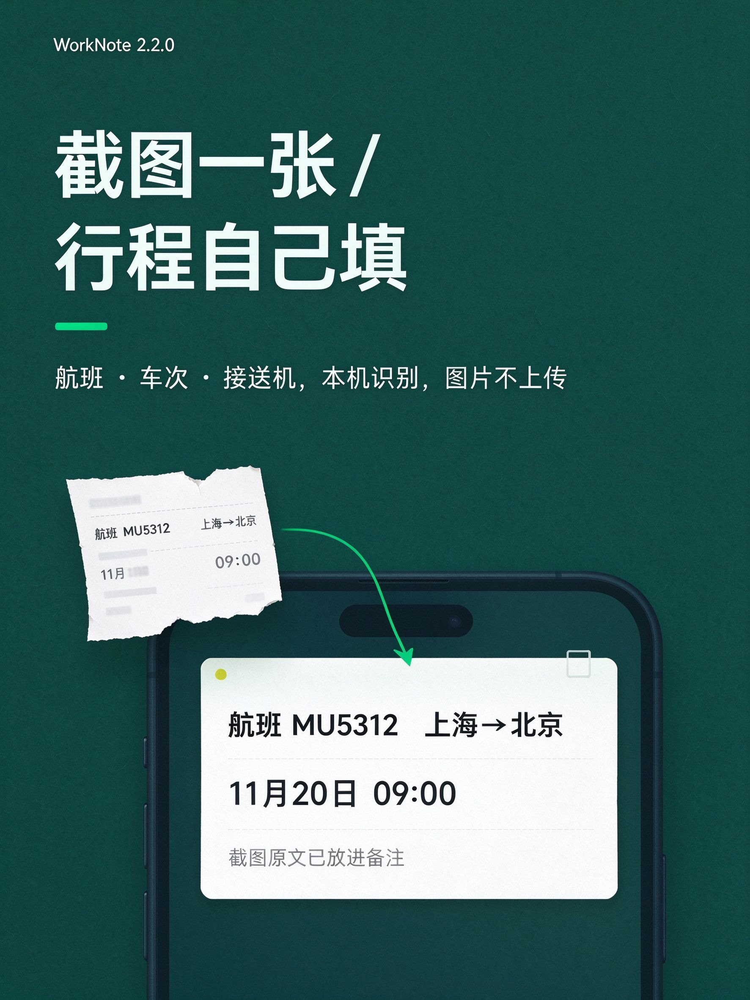
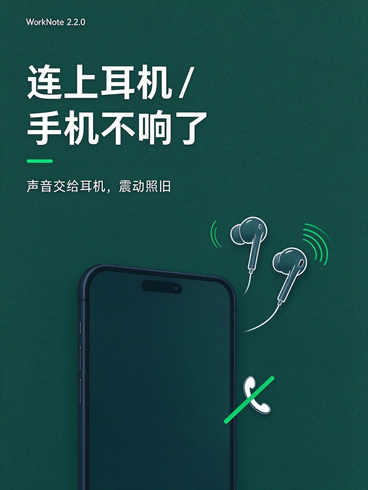
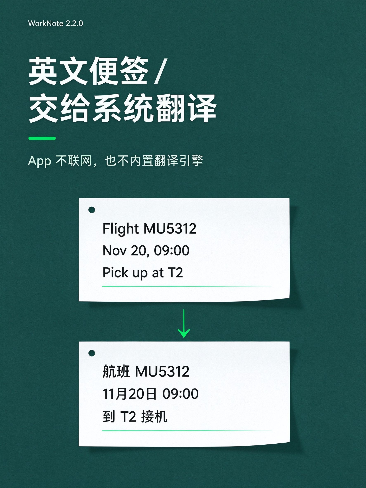
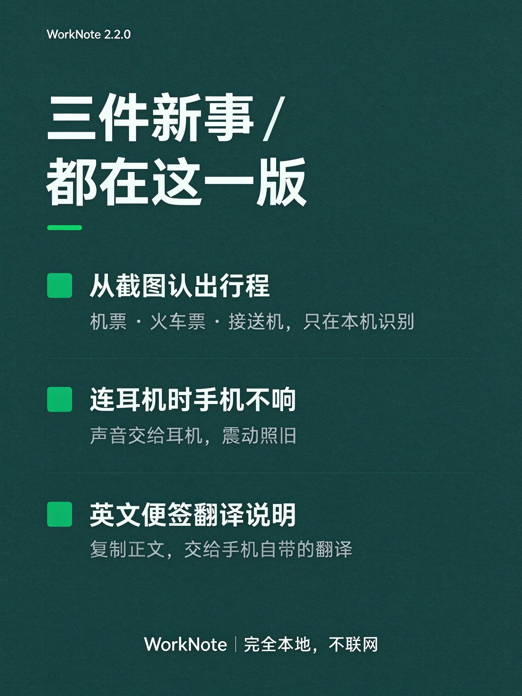

# 工作便签提醒（WorkNote）

一个**完全本地、不联网、不用账号**的强提醒便签 App：到点弹一张盖在屏幕最上层的卡片，卡片上没有关闭按钮，**必须点了自己配的按钮才会消失**。

单机自用为主，顺便开源出来给需要的人，**不上架任何应用商店**。

- 版本：2.2.0（三端同一份数据，同一个包名 `com.workspace.worknote`）
- 许可证：**GPL-3.0**（全文见 [LICENSE](LICENSE)）
- 语言：跟随系统 / 简体中文 / 繁體中文 / English（三端都是四档）
- 主题：跟随系统 / 浅色 / 深色；字号 1~10 档

> 想自己编译、改代码、看验机记录？看 [开发者说明](开发者说明.md)。这份 README 只讲「装上之后怎么用」。

## 一、能做什么

- **到点跑不掉**：卡片占满屏、背景压暗，没有 ×、没有「稍后再说」，点背景和返回键都关不掉——只有你自己配的按钮能关。
- **按钮自己定**：文字随便写，动作三选一：标记完成 / 延后 / 只关这张卡片。
- **三种提醒方式任意组合**：定时提醒、循环重复（每天 / 每周 / 每月）、未处理就再弹（分钟级冷却）。
- **关联日期**：一条便签能挂在一个日期上，日程页按天列出当天要做的事。
- **日程两种看法**：垂直（按天往下排）和日历（整月网格），两种都能左右滑动翻月，左滑下个月、右滑上个月。
- **提醒铃声自定义**：从手机里选一首，提醒时只放你选的这首。
- **回收站**：删错了能捞回来，也能多选一次清干净。
- **功能说明页**：15 节讲清每个页面怎么用，还能整页朗读。
- **从截图新建便签**（2.2.0）：选一张机票 / 火车票 / 接送机截图，自动认出航班号、车次、站名、日期时间，填进标题和提醒，截图原文进备注。识别在本机做，图片不上传。
- **连着耳机时不吵人**（2.2.0）：蓝牙耳机或音箱连着，铃声交给耳机，手机喇叭不出声，震动照旧。
- **数据只在你这台手机上**：便签存本机数据库，没有网络请求、没有账号、没有云同步、没有统计埋点；备份是你自己导出的一个文件。

## 二、三端各自能用到什么程度

| 平台 | 能不能装 | 说明 |
| --- | --- | --- |
| Android | **能** | 签名安装包在真机跑过，强提醒卡片、悬浮窗、自定义铃声、四档语言都实测过 |
| iOS | **暂不能**（给源码） | 要出安装包得有 macOS + Xcode + 你自己的 Apple ID 签名 |
| HarmonyOS NEXT | **暂不能**（给源码） | 要出 `.hap` 得有 DevEco Studio 与本机签名证书 |

说直白点：**现在只有 Android 有真正的安装包**，另外两端交的是源码，谁有对应工具链谁自己编。

## 三、下载与安装

### Android（可用）

从本仓库 [Releases](../../releases) 下载 `WorkNote-2.2.0-android-release.apk`，传到手机点开装（要允许「安装未知来源应用」）。或用 adb：

```powershell
adb install -r WorkNote-2.2.0-android-release.apk
```

装好**务必**进【我】页把四项权限点亮（悬浮窗、忽略电池优化、通知、精确闹钟）；国产 ROM 还要单独开「自启动」和「后台运行」，否则到点可能不弹卡片。

> 安装包约 46 MB。比一般便签 App 大很多，因为里面打包了离线中文识别模型——换来的是截图识别全程在本机做，图片不出手机。

### iOS（源码，需自己编）

```bash
cd ios-app
brew install xcodegen
xcodegen generate --spec project.yml
open WorkNote.xcodeproj      # Xcode 里选自己的 Team 再选真机运行
```

### HarmonyOS NEXT（源码，需自己编）

用 DevEco Studio 打开 `ohos-app/`，`compatibleSdkVersion` 是 `5.0.0(12)`；真机安装前要在 DevEco 里配好签名。

## 四、强提醒是怎么做到的

1. 到点由系统闹钟唤醒，卡片用悬浮窗盖在最上层，背景压暗。
2. 卡片上没有关闭按钮，也没有「稍后再说」；点背景、按返回键都不消失。
3. 每条便签的按钮自己配：文字自定，动作三选一——标记完成 / 延后 / 只关卡片。
4. 没给悬浮窗权限时，自动退回全屏提醒页，规则完全一样。
5. 通知栏会有一条常驻通知，这是系统对后台服务的硬性要求，不是你的便签提醒，删不掉。

> iOS 与 HarmonyOS 不开放第三方全局悬浮窗，同一件事在那边只能降级成「通知 + 高频催办」，通知仍可被划掉。

## 五、数据在哪、隐私

- 所有便签只存在本机数据库（`worknote.db`），**没有网络请求、没有账号、没有云同步、没有统计埋点**。
- 备份文件名 `WorkNote_年月日_时分.taskbak`，写在系统「下载/工作便签提醒」目录，纯 JSON，你自己能打开看。
- 卸载 App 会连同数据库一起删掉（系统行为），换机前先在【我】页导出备份。
- 英文便签想看中文：长按正文复制，粘到手机自带翻译里就行——App 不联网，也不内置翻译引擎。

## 六、已知限制

1. **只有 Android 能做「不可关闭的置顶卡片」**；iOS 与 HarmonyOS 只能「通知 + 高频催办」。
2. 国产 ROM 的省电策略会延迟甚至杀掉后台闹钟，需要手动加白名单。
3. 后台服务的常驻通知无法隐藏，系统强制。
4. 日程页两种模式都按当月实际天数算（28~31 天），二月没有 30、31 号；日历网格按周日打头。
5. HarmonyOS 端英文界面里日期单位「年 / 月 / 日」仍是中文，后续统一。

## 七、宣传物料

十三张图都在 `docs/promo/` **同一个文件夹**里，按出图先后排成 `01`~`13`，分三套视觉。图内中文由图像模型生成，正式对外发布前请按原图逐字核一遍。

**第一套（01~05）**：品牌绿 #07C160 只做强调，文字深墨绿 #10403B，冷白纸面。


**第二套（06~09）**：深墨绿满版，品牌绿只做箭头与选中块。


**第三套（10~13，2.2.0）**：深墨绿 + 微信绿描边。









## 八、更新记录

- **2.2.0**（2026-11-11）：新建便签页支持「从截图识别行程」；连着蓝牙耳机时提醒不再从手机外放；功能说明页补三节（蓝牙与响铃、英文便签怎么翻译、用行程截图新建便签），全页 12 节变 15 节。宣传页新增 `10`~`13`。
- **2.1.0**（2026-11-11）：回收站加多选与全部删除；设置页分组标题默认收起、点开才展开；新增功能说明页并支持整页朗读；日程加「垂直 / 日历」两种显示模式，两种都能左右滑动翻月（左滑下个月、右滑上个月）；说明页讲清关联日期、定时提醒、循环三者怎么配合。
- **1.0.1**（2026-11-08）：便签行右侧日期补上年份（设了提醒显示到时分，没设只显示日期）。
- **1.0.0**（2026-11-08）：首个公开版本，Android 可装，iOS / HarmonyOS 为源码。

## 九、开源

代码按 GPL-3.0 公开，可以免费用、改、二次分发，但**改完再发布必须同样以 GPL-3.0 开源并保留出处**。没有担保，装在自己手机上有任何问题自行承担。

改出了更好的版本，欢迎提 issue / PR；fork 走自己的路也完全没问题——编译方式、签名、三端验证到哪一步，都在 [开发者说明](开发者说明.md)。
